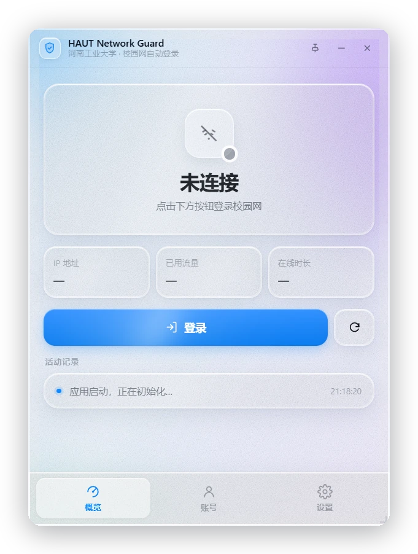
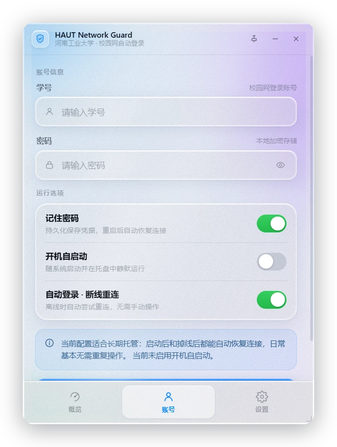
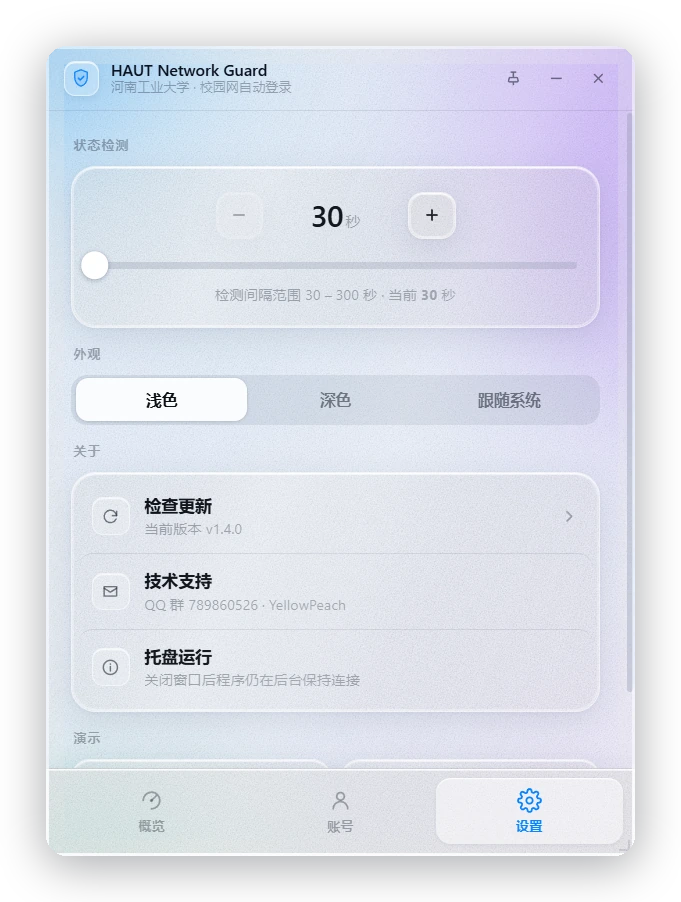
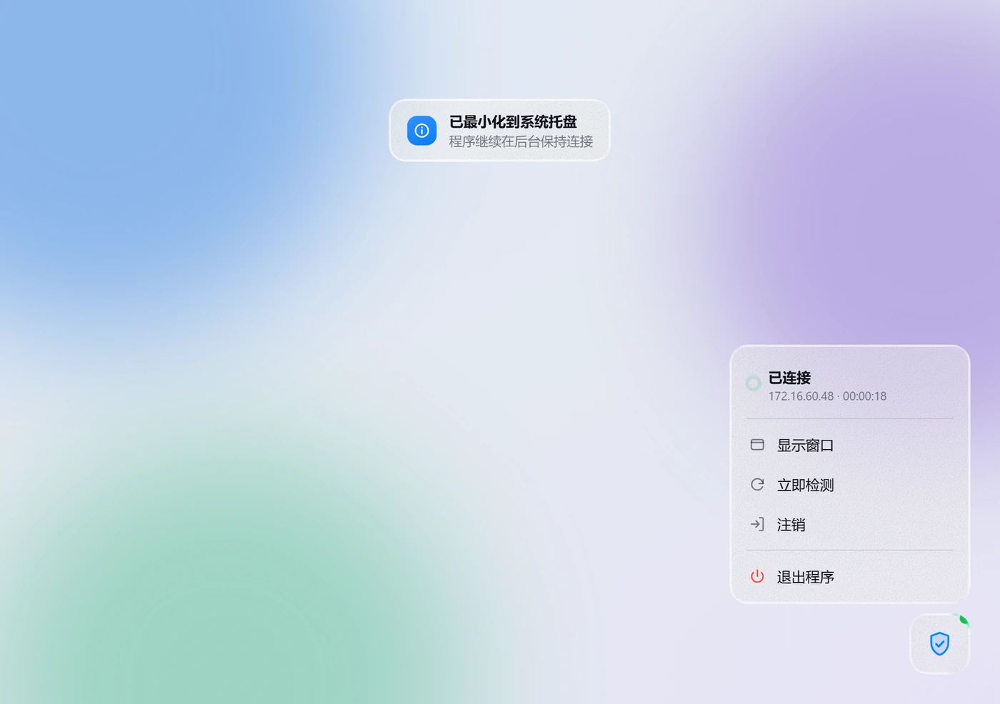
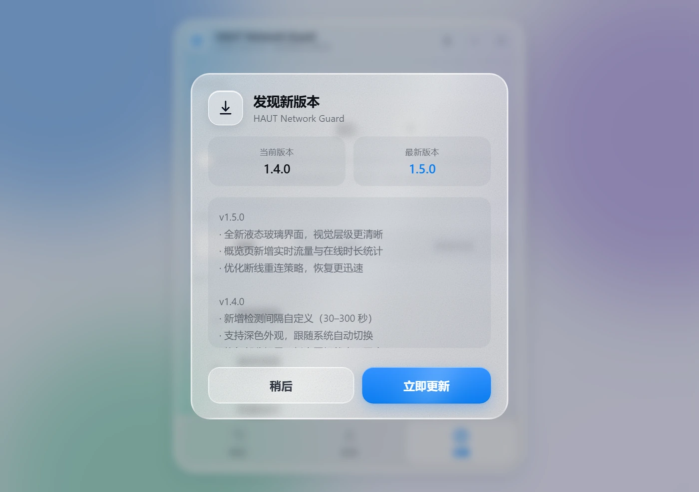

<div align="center">

# HAUT Network Guard · Liquid Glass

**河南工业大学校园网自动登录工具 —— 液态玻璃版本**

界面就是程序本身。不是网页，不是浏览器套壳，是一个双击就能用的 Windows 桌面程序。


**[⬇️ 下载程序](https://github.com/j7nyi4113-crypto/HAUTNetworkGuard-LiquidGlass/releases/latest)** · **[🔗 网页预览](https://j7nyi4113-crypto.github.io/HAUTNetworkGuard-LiquidGlass/)** · **[原项目](https://github.com/yellowpeachxgp/HAUTNetworkGuard)**

</div>

<p align="center">
  
</p>

---

## 下载：先看你在哪种情况

| 你的情况 | 下载 | 里面是什么 |
| :--- | :--- | :--- |
| **想直接能用** | [**程序包**](https://github.com/j7nyi4113-crypto/HAUTNetworkGuard-LiquidGlass/releases/download/v1.4.0/HAUTNetworkGuard-LiquidGlass-v1.4.0.zip)<br>`390KB` | 双击就跑的 Windows 程序，界面就是液态玻璃 |
| **只想要界面文件** | [**界面包**](https://github.com/j7nyi4113-crypto/HAUTNetworkGuard-LiquidGlass/releases/download/v1.4.0/HAUTNetworkGuard-UI-v1.4.0.zip)<br>`20KB` | `index.html` + 截图，浏览器里打开看效果 |

程序包解压后双击 `HAUTNetworkGuard.exe` 即可，**不需要安装 .NET 运行时**
（基于系统自带的 .NET Framework 4.8），也不需要 Node、Python 或任何依赖。

> [!NOTE]
> 唯一的前置条件是 Microsoft Edge WebView2 Runtime。Windows 11 和较新的 Windows 10
> 默认已自带；万一提示缺失，[点这里装一次](https://developer.microsoft.com/microsoft-edge/webview2/)就好。

---

## 它和之前那个「浏览器演示」的区别

上一版是把界面做成 HTML，靠浏览器打开，`exe` 还是原版界面 —— 两者是分开的。
这一版把界面真正放进了程序窗口：

|  | 上一版 | 这一版 |
| :--- | :--- | :--- |
| 打开方式 | 浏览器标签页 / `--app` 模式 | 双击 `HAUTNetworkGuard.exe` |
| 窗口 | 浏览器的窗口 | 无边框圆角窗口，界面即窗口 |
| 登录 | 模拟，不联网 | **真实登录**，走校园网网关 |
| 体积 | 20 KB（只有界面） | 390 KB（完整程序） |

具体做法：**.NET Framework 4.8 + WinForms 承载 WebView2**，界面是 HTML，
但渲染在程序自己的窗口里，通过 `postMessage` 与 C# 后端双向通信；
登录协议用 C# 重写，直接对接校园网网关。

---

## 关于本项目

本项目是 [**yellowpeachxgp/HAUTNetworkGuard**](https://github.com/yellowpeachxgp/HAUTNetworkGuard) 的**界面重设计分支**。

原项目是成熟的跨平台校园网自动登录工具（macOS / Windows / OpenWrt / Linux），
Windows 端基于 C++ 与 Qt 6 Widgets。本项目保留其协议与产品逻辑，
把 Windows 端的界面层替换为液态玻璃方案。

### 与原项目的关系

| | 原项目 HAUTNetworkGuard | 本项目 |
| :--- | :--- | :--- |
| 定位 | 跨平台客户端 | Windows 端界面重设计版 |
| 界面技术 | C++ / Qt 6 Widgets | C# / WinForms + WebView2 |
| 协议 | SRUN3K | SRUN3K（移植自原项目） |
| 许可 | MIT | MIT（继承） |

原项目作者 **YellowPeach** · QQ 群 `789860526`

> 校园网协议的实现（加密、请求构造、响应解析）逐条移植自原项目的
> `Windows/src/api.cpp` 与 `protocol_utils.cpp`，并做过逐字节比对校验。

---

## 设计目标

第一版原型做出来后问题很集中——**过于"AI 化"，且玻璃是假的**。重做时针对这几点。

| 问题 | 具体表现 | 处理方式 |
| :--- | :--- | :--- |
| 视觉噪音过多 | 窗口内叠了彩色极光光斑、高饱和彩虹壁纸、大色块发光圆球、彩色图标底、厚重渐变阴影 | 全部移除。改为中性冷底 + 三道低饱和色雾，全站单一强调色 `#0a84ff` |
| 玻璃不透明 | 面板用 `rgba(255,255,255,.55)`，几乎看不到背景，只有模糊没有折射 | 填充降到 `0.11 ~ 0.20`，叠加三层结构（见下节） |
| 没有磨砂质感 | 纯色半透明，缺少颗粒 | 加 `feTurbulence` 生成的细颗粒，融入玻璃 |
| 没有流动感 | 全静态 | 色雾缓慢漂移 + 各玻璃面镜面高光扫过 |

---

## 液态玻璃是怎么做的

核心是把一块玻璃拆成**三层**：

```
① 本体       极低不透明度着色 + backdrop-filter 模糊 + 磨砂颗粒
② ::before   边缘折射环 —— 用 mask 把全尺寸元素裁成 1.6~2.2px 环带
③ ::after    流动镜面高光 —— 斜向渐变 + blur 柔化后横向扫过
```

### ② 边缘折射：让光在玻璃边上弯一下

用 `mask-composite: exclude` 把伪元素裁成一条环带，再对环带单独做一次
`backdrop-filter`（`saturate(230%) brightness(1.18) contrast(1.08)`）：

```css
.card::before {
  content: "";
  position: absolute;
  inset: 0;
  border-radius: inherit;
  padding: 1.6px;                       /* 环带宽度 */
  backdrop-filter: blur(2.5px) saturate(210%) brightness(1.15) contrast(1.06);
  mask: linear-gradient(#000 0 0) content-box, linear-gradient(#000 0 0);
  mask-composite: exclude;              /* 只留边框那一圈 */
}
```

### 真·折射：`backdrop-filter: url(#svg-filter)`

只做亮度提升只是"像"玻璃。真正的折射要让背景内容在边缘被**弯折**。

关键在于：`::before` 元素本身是 `inset: 0` 的**全尺寸**元素，只是被 `mask` 裁成了环带。
所以它的滤镜区域覆盖整个窗口，`feDisplacementMap` 有完整的背景可以采样 ——
这一点决定了位移滤镜在窄环带上依然能生效。

```html
<filter id="lgWarp">
  <feTurbulence type="fractalNoise" baseFrequency="0.004 0.006" numOctaves="2" seed="11" result="n" />
  <feGaussianBlur in="n" stdDeviation="2.5" result="soft" />
  <feDisplacementMap in="SourceGraphic" in2="soft" scale="30"
                     xChannelSelector="R" yChannelSelector="G" />
</filter>
```

```css
.app-window::before {
  backdrop-filter: blur(3px) saturate(230%) brightness(1.18) contrast(1.08) url(#lgWarp);
}
```

> 实测：开启 / 关闭该滤镜渲染同一帧，约 **6% 的像素差异超过 6 级、峰值 68 级**。

### ③ 流动感

两处叠加，都很慢：

- **色雾**每 34 / 40 / 46 秒漂移一轮，透过半透明玻璃可见 → 玻璃是"活"的
- **镜面高光**每块玻璃面独立扫过，用 `--sweep-delay` 错开相位，避免整齐划一

```css
.card::after {
  background: linear-gradient(100deg, transparent, rgba(255,255,255,.30), transparent);
  mix-blend-mode: screen;
  filter: blur(16px);                   /* 柔化成一片光，而不是一道亮边 */
  animation: lgSweep var(--sweep-dur, 14s) linear infinite;
}
```

---

## 功能

- **真实登录 / 注销**：对接校园网网关（SRUN3K），不是模拟
- **状态监测**：默认 30 秒轮询，可调 30 – 300 秒，掉线自动重连
- **三个视图**：概览 / 账号 / 设置，底部胶囊导航（窄）↔ 左侧边栏（宽）
- **实时读数**：IP、已用流量、在线时长，服务端数据 + 本地按秒插值
- **运行选项**：记住密码、开机自启、自动登录
- **外观**：浅色 / 深色 / 跟随系统
- **系统托盘**：关闭窗口缩到托盘继续守着，右键菜单可检测 / 登录 / 退出
- **窗口**：无边框圆角、拖拽移动、右下角拖拽缩放、可置顶
- **凭据安全**：密码用 Windows DPAPI 加密，绑定当前用户

---

## 界面一览

<p align="center">
  
  
  
</p>

深色模式、宽屏双栏、托盘菜单、更新弹窗：

<p align="center">
  
  
</p>
<p align="center">
  
  
</p>

---

## 从源码构建

需要 [.NET SDK 8](https://dotnet.microsoft.com/download)（用于编译，运行不需要）。

```bash
git clone https://github.com/j7nyi4113-crypto/HAUTNetworkGuard-LiquidGlass.git
cd HAUTNetworkGuard-LiquidGlass
dotnet build app/LiquidGlass.csproj -c Release
```

产物在 `app/bin/Release/net48/`，整个目录拷走即可运行。

项目结构：

```
app/
├── LiquidGlass.csproj      # net48 + WebView2
├── Program.cs              # 入口、单实例、--selftest
├── MainForm.cs             # 无边框窗口、WebView2、托盘、轮询
├── SrunClient.cs           # SRUN3K 协议
└── AppConfig.cs            # 配置 + DPAPI
index.html                  # 界面（构建时复制进 wwwroot，同一份文件）
```

`index.html` 只有一份：构建时复制到 `wwwroot`，浏览器里打开则退化为纯前端演示。

### 自检

```bash
HAUTNetworkGuard.exe --selftest
```

离屏加载界面、跑一遍协议校验、把三个视图截到 `%TEMP%`，不弹窗不抢焦点。
结果写在 `%TEMP%\haut-selftest.txt`。

---

## 已知限制

- **仅适用于河南工业大学校园网**：网关地址硬编码为 `172.16.154.130`，其他学校不通用。
- **浏览器兼容性**：网页预览里 `backdrop-filter: url()` 目前仅 Chromium 系支持，
  Firefox / Safari 会退化为纯亮边。程序内置 WebView2，不受影响。
- **性能**：主玻璃面叠加了全尺寸 SVG 位移滤镜，低配设备上可能掉帧。
  代码已针对 `prefers-reduced-motion` 关闭全部动画。
- **未做代码签名**：首次运行 Windows SmartScreen 可能提示「未知发布者」，选「仍要运行」。

---

## 数据与隐私

- 配置存在 `%APPDATA%\HAUTNetworkGuard\config.json`
- 密码用 DPAPI 加密，绑定当前 Windows 用户，换用户或换机器都解不开
- 程序不收集、不上传任何数据；除校园网网关外不连接任何服务器

---

## 致谢

- 原项目：[yellowpeachxgp/HAUTNetworkGuard](https://github.com/yellowpeachxgp/HAUTNetworkGuard) — 作者 **YellowPeach**
- 设计语言参考：Apple Liquid Glass

## 许可证

[MIT](LICENSE) —— 继承自原项目。原始版权归 YellowPeach 所有。
随包分发的 WebView2 SDK 遵循其自身许可。
