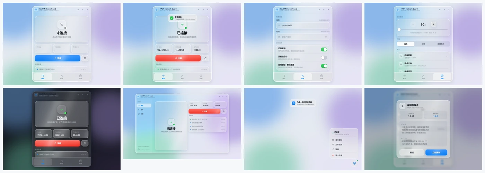
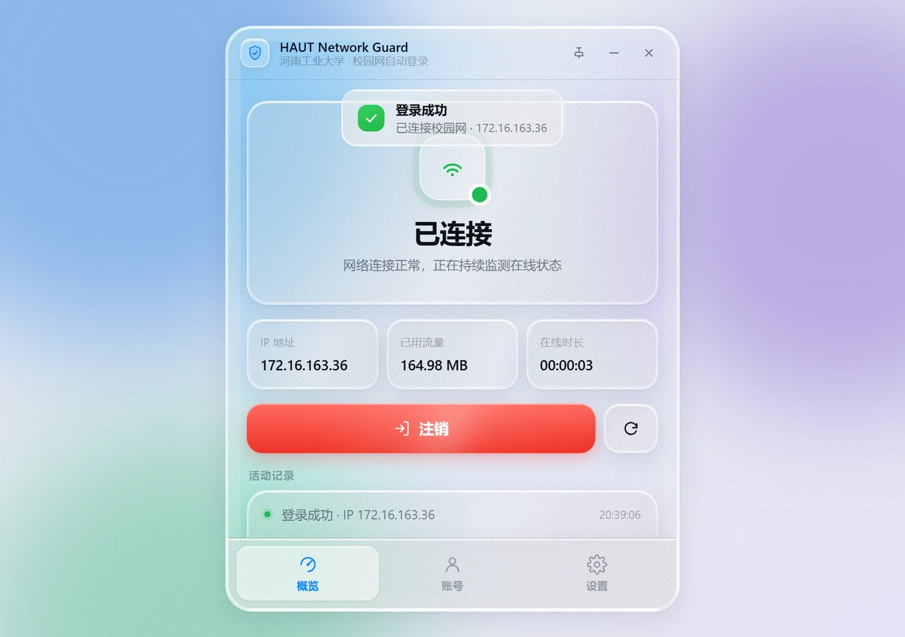
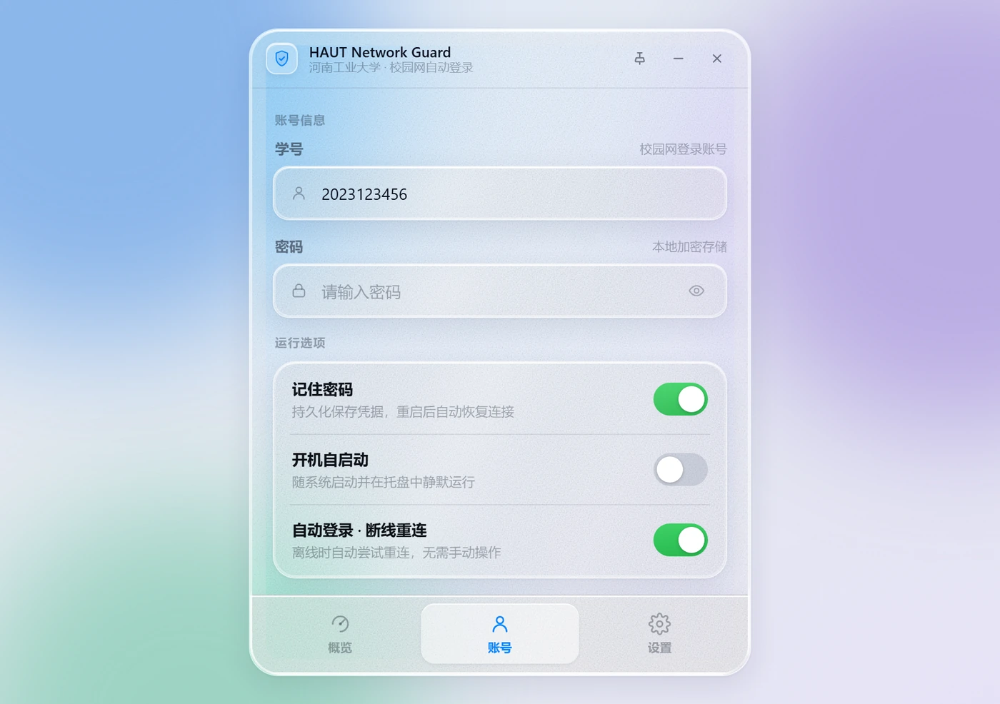
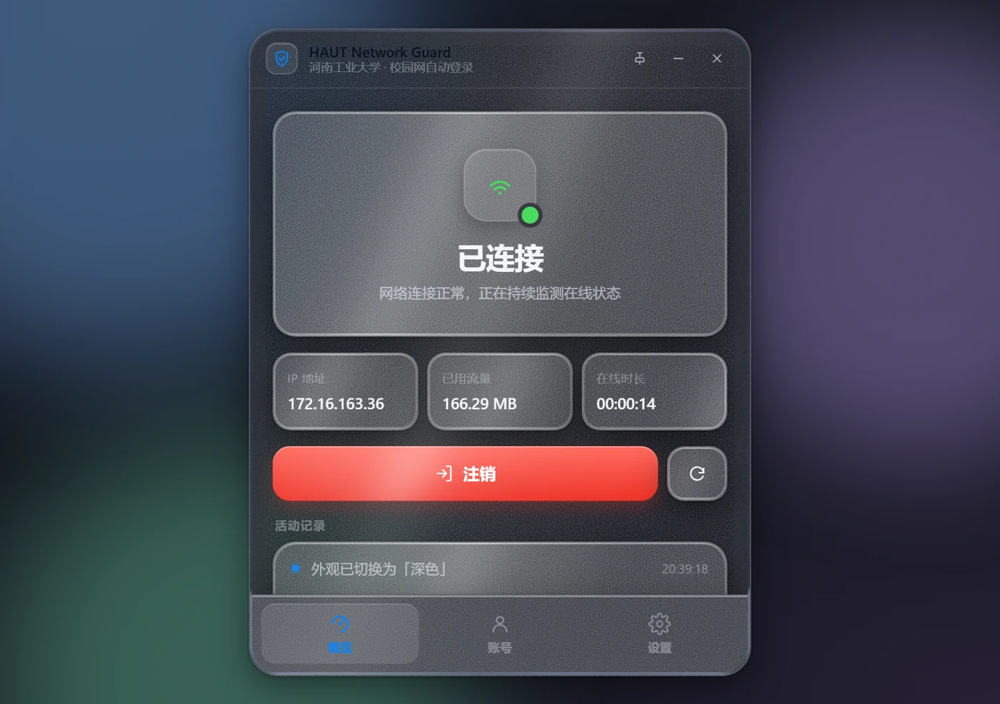
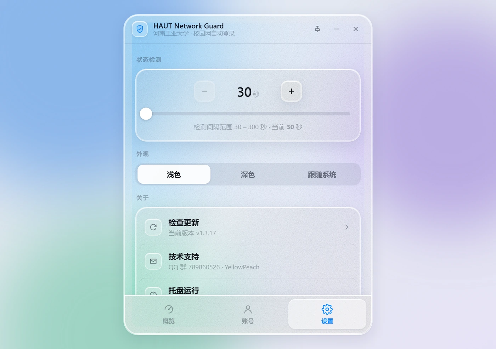
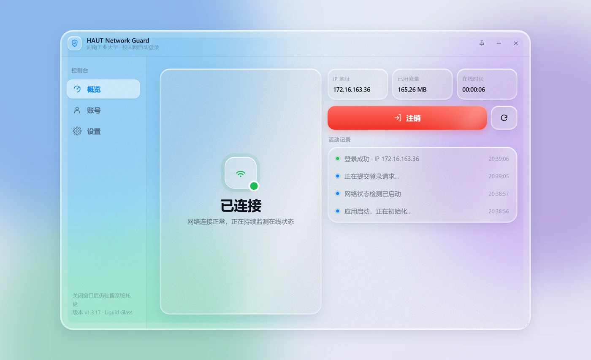

<div align="center">

# HAUT Network Guard · Liquid Glass

**河南工业大学校园网自动登录工具 —— 液态玻璃界面重设计**

A Liquid Glass UI redesign prototype for [HAUTNetworkGuard](https://github.com/yellowpeachxgp/HAUTNetworkGuard).


**[🔗 在线演示](https://j7nyi4113-crypto.github.io/HAUTNetworkGuard-LiquidGlass/)** · **[原项目](https://github.com/yellowpeachxgp/HAUTNetworkGuard)**

</div>



---

## 关于本项目

本项目是 [**yellowpeachxgp/HAUTNetworkGuard**](https://github.com/yellowpeachxgp/HAUTNetworkGuard) 的**界面重设计分支**。

原项目是一个成熟的跨平台校园网自动登录工具，支持 macOS、Windows、OpenWrt 与通用 Linux 四个平台，
Windows 端基于 C++ 与 Qt 6 Widgets 实现，功能完整、长期维护。

本项目**只重做界面层**，不涉及任何登录协议、网络逻辑或凭据处理：

- 输出单文件 HTML 高保真原型，用于验证新版视觉方案
- 功能、状态机与交互流程对齐原版 Windows 客户端
- 可作为后续落地为 Qt QSS / QML 的设计基准

> [!IMPORTANT]
> 本仓库**不包含可执行程序**，也无法实际登录校园网。
> 需要能用的客户端，请前往 [原项目](https://github.com/yellowpeachxgp/HAUTNetworkGuard) 下载。

### 与原项目的关系

|                | 原项目 HAUTNetworkGuard | 本项目 |
| -------------- | ----------------------- | ------ |
| 定位           | 可直接使用的客户端      | 界面设计原型 |
| 平台           | macOS / Windows / OpenWrt / Linux | 浏览器 |
| 技术栈         | Swift / C++ Qt 6 / Lua  | 单文件 HTML + CSS + 原生 JS |
| 校园网协议     | SRUN3K                  | 不包含协议实现 |
| 凭据存储       | Keychain / DPAPI / UCI  | 不涉及 |
| 许可           | MIT                     | MIT（继承） |

原项目作者 **YellowPeach** · QQ 群 `789860526`

---

## 设计目标

第一版原型做出来后问题很集中——**过于"AI 化"，且玻璃是假的**。第二版针对这两点重做。

| 问题 | 具体表现 | 处理方式 |
| ---- | -------- | -------- |
| 视觉噪音过多 | 窗口内叠了一层彩色极光光斑、高饱和彩虹壁纸、大色块发光圆球、彩色图标底、厚重渐变阴影 | 全部移除。改为中性冷底 + 三道低饱和色雾，全站单一强调色 `#0a84ff` |
| 玻璃不透明 | 面板用 `rgba(255,255,255,.55)`，几乎看不到背景，只有模糊没有折射 | 填充降到 `0.11 ~ 0.20`，叠加三层结构（见下节） |
| 没有磨砂质感 | 纯色半透明，缺少颗粒 | 加 `feTurbulence` 生成的细颗粒，`background-blend` 融入玻璃 |
| 没有流动感 | 全静态 | 桌面色雾缓慢漂移 + 各玻璃面镜面高光扫过 |

---

## 液态玻璃是怎么做的

核心是把一块玻璃拆成**三层**，各司其职：

```
① 本体       极低不透明度着色 + backdrop-filter 模糊 + 磨砂颗粒
② ::before   边缘折射环 —— 用 mask 把全尺寸元素裁成 1.6~2.2px 环带
③ ::after    流动镜面高光 —— 斜向渐变 + blur 柔化后横向扫过
```

### ② 边缘折射：让光在玻璃边上弯一下

这是"液态玻璃"最关键的一笔。用 `mask-composite: exclude` 把伪元素裁成一条环带，
再对环带单独做一次 `backdrop-filter`（`saturate(230%) brightness(1.18) contrast(1.08)`）：

```css
.card::before {
  content: "";
  position: absolute;
  inset: 0;
  border-radius: inherit;
  padding: 1.6px;                       /* 环带宽度 */
  backdrop-filter: blur(2.5px) saturate(210%) brightness(1.15) contrast(1.06);
  mask: linear-gradient(#000 0 0) content-box, linear-gradient(#000 0 0);
  mask-composite: exclude;              /* 只留边框那一圈 */
}
```

### 真·折射：`backdrop-filter: url(#svg-filter)`

只做亮度提升只是"像"玻璃。真正的折射需要让背景内容在边缘被**弯折**。

关键点在于：`::before` 元素本身是 `inset: 0` 的**全尺寸**元素，只是被 `mask` 裁成了环带。
所以它的滤镜区域覆盖整个窗口，`feDisplacementMap` 有完整的背景可以采样——
这一点决定了位移滤镜在窄环带上依然能生效。

```html
<filter id="lgWarp">
  <feTurbulence type="fractalNoise" baseFrequency="0.004 0.006" numOctaves="2" seed="11" result="n" />
  <feGaussianBlur in="n" stdDeviation="2.5" result="soft" />
  <feDisplacementMap in="SourceGraphic" in2="soft" scale="30"
                     xChannelSelector="R" yChannelSelector="G" />
</filter>
```

```css
.app-window::before {
  backdrop-filter: blur(3px) saturate(230%) brightness(1.18) contrast(1.08) url(#lgWarp);
}
```

窗口内还叠了一层 14px 宽的 `.lens-band`，用更弱的位移量做出"由边缘向内衰减"的镜片感。

> 实测：开启 / 关闭该滤镜渲染同一帧，约 **6% 的像素差异超过 6 级、峰值 68 级**。

### ③ 流动感

两处叠加，都很慢：

- **桌面色雾**每 34 / 40 / 46 秒漂移一轮，透过半透明玻璃可见 → 玻璃"活"的
- **镜面高光**每块玻璃面独立扫过，用 `--sweep-delay` 错开相位，避免整齐划一

```css
.card::after {
  background: linear-gradient(100deg, transparent, rgba(255,255,255,.30), transparent);
  mix-blend-mode: screen;
  filter: blur(16px);                   /* 柔化成一片光，而不是一道亮边 */
  animation: lgSweep var(--sweep-dur, 14s) linear infinite;
}
```

---

## 功能

原型完整实现了原版 Windows 客户端的交互流程，可点击操作：

- **三个视图**：概览 / 账号 / 设置，底部胶囊导航（窄屏）↔ 左侧边栏（宽屏）
- **状态机**：`offline` / `checking` / `online` / `error`，含自动登录、断线重连、手动离线保持
- **登录 / 注销**：模拟请求延迟，成功后填充 IP、实时刷新流量与在线时长
- **运行选项**：记住密码、开机自启、自动登录（联动底部提示文案）
- **检测间隔**：30 – 300 秒，步进器 + 滑块双向同步
- **外观**：浅色 / 深色 / 跟随系统，托盘与弹窗同步切换
- **系统托盘**：最小化动画、托盘图标、右键菜单
- **其他**：更新弹窗（版本对比 + 更新日志）、Toast 提示、活动记录、右下角拖拽缩放

### 响应式

用 **容器查询**（`container-type: inline-size`）而非媒体查询——窗口是桌面应用，
用户拖拽改变的是窗口宽度，不是视口宽度。宽度超过 720px 自动切为双栏布局。

---

## 界面一览

<p align="center">
  
  
</p>
<p align="center">
  
  
</p>
<p align="center">
  
</p>

---

## 目录结构

```
.
├── index.html              # 全部内容：HTML + CSS + JS，单文件
├── preview/                # 界面截图（WebP）
│   ├── 01-status-offline.webp
│   ├── 02-status-online.webp
│   ├── 03-account.webp
│   ├── 04-settings.webp
│   ├── 05-dark.webp
│   ├── 06-wide.webp
│   ├── 07-tray.webp
│   ├── 08-update-modal.webp
│   └── overview.webp
├── LICENSE
└── README.md
```

---

## 运行

没有任何构建步骤，也不需要装依赖：

```bash
git clone https://github.com/j7nyi4113-crypto/HAUTNetworkGuard-LiquidGlass.git
cd HAUTNetworkGuard-LiquidGlass
```

双击 `index.html`，或者：

```bash
python -m http.server 8000
# 打开 http://localhost:8000
```

> 建议用 Chromium 内核浏览器（Chrome / Edge）查看，液态玻璃的折射效果依赖
> `backdrop-filter` 与 `mask-composite`。

---

## 已知限制

- **仅为视觉原型**：所有网络请求都是模拟的，不连接真实网关，也不存储任何凭据。
- **浏览器兼容性**：`backdrop-filter: url()` 目前仅 Chromium 系支持。Firefox / Safari
  会退化为纯亮边（不影响整体观感），其余部分正常。
- **性能**：主玻璃面叠加了全尺寸 SVG 位移滤镜，低端设备上可能掉帧。
  代码里已针对 `prefers-reduced-motion` 关闭全部动画。

---

## 致谢

- 原项目：[yellowpeachxgp/HAUTNetworkGuard](https://github.com/yellowpeachxgp/HAUTNetworkGuard) — 作者 **YellowPeach**
- 设计语言参考：Apple Liquid Glass

## 许可证

[MIT](LICENSE) —— 继承自原项目。原始版权归 YellowPeach 所有。
